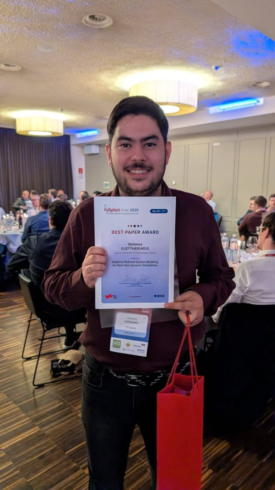

Our PhD candidate [Stefanos Eleftheriadis](/group/stefanos-eleftheriadis/) received the **Best Paper Award** at the [Power System Dynamics Summit (PoSyDyS 2026)](https://posydys.tugraz.at/), held on 9–11 September 2026 in Graz, Austria, and organised by Graz University of Technology. Congratulations Stefanos and co-authors!

The award-winning paper is:

> **[Adaptive Reduced System Modeling for Real-time Dynamic Simulations](/publication/2026celeftheriadis/)**
> {}, {}, {}, T. Vermeulen, G. Joseph, {}

## About the work

The paper proposes an adaptive approach to reducing large-scale power system models while preserving the level of detail needed for accurate dynamic simulations. Given the operating state and the location of a disturbance, graph-neural-network predictors identify which substations need full detail and simplify the rest. On a realistic French transmission network model with more than 6,000 buses, the method cuts model size by about 60% and speeds up simulation by up to 2.6×, with errors below the solver tolerance.

This is an important step towards real-time dynamic simulation of large power systems, one of the key challenges addressed by the **[TRAISIM](/project/traisim/)** project, developed with [CRESYM](https://cresym.eu) and RTE. CRESYM also [shared the news](https://www.linkedin.com/feed/update/urn:li:activity:7505204760971616258/) on LinkedIn.

Read more about [our participation in PoSyDyS 2026](/post/2026_posydys/).
